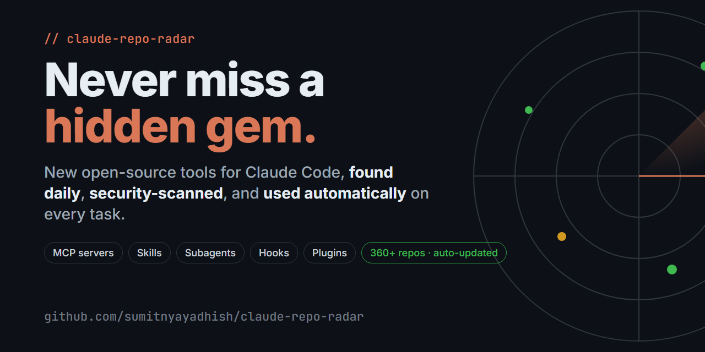

# 📡 Claude Repo Radar — never miss a new open-source tool for Claude Code



[](https://github.com/sumitnyayadhish/claude-repo-radar/actions/workflows/discover.yml)
[](LICENSE)
[](#install-claude-code)
[](../../issues/new?template=suggest-repo.yml)

**Stop chasing GitHub links from reels, tweets and YouTube.** New Claude Code MCP servers, skills,
subagents, hooks and plugins come out every day. You don't need to track any of them yourself.

Repo Radar is an **auto-updating awesome list** of hidden open-source repos for Claude Code, plus a
**Claude Code plugin**. Once it's installed, **every task you give Claude Code automatically gets
checked against the newest open-source tools.** Claude picks the right one, security-checks it and
uses it (with your OK), so results go a level up without you lifting a finger.

✅ Updated **every day** automatically · ✅ Every repo **security-scanned** · ✅ Works on **every prompt** · ✅ Free & open source

> रील्स में रोज़ नई "hidden" GitHub repos आती हैं, और सबका track रखना मुश्किल है। Repo Radar यह काम
> अपने-आप करता है: रोज़ नई repos ढूँढता है, security check करता है, और Claude Code में हर task
> के साथ बताता है कि कौन-सी repo से result और अच्छा बनेगा।

## How it works

```
 Daily GitHub Action ──► search GitHub (claude-code, mcp-server, skills, hooks…)
        │                 keep "hidden gems": young, fast-rising, active
        ▼
 Security scan (read-only) ──► 🔴 high risk → quarantine (never suggested)
        │                      🟡 medium → suggested with warnings
        ▼                      🟢 low
 catalog/repos.json ──► plugin auto-updates
        │
        ▼
 You type a task in Claude Code
        │  UserPromptSubmit hook matches it against the catalog
        ▼
 Claude sees the top matches → live GitHub search if nothing fits
        → security-reviews the repo → asks you → uses it → better result
```

- **Auto discovery**: [`discover.yml`](.github/workflows/discover.yml) runs every day.
- **Community + reels**: anyone can open a [Suggest a repo](../../issues/new?template=suggest-repo.yml)
  issue. The bot scans the repo, adds it and closes the issue.
- **Per-task suggestions**: a `UserPromptSubmit` hook adds at most 5 relevant repos to Claude's
  context. It stays silent when nothing matches.
- **Live search**: the `repo-radar` skill tells Claude how to search GitHub live for bigger tasks.
- **Security first**: nothing gets installed or run without your OK. Claude reads install scripts,
  hooks and MCP configs before using anything.

## Install (Claude Code)
<a id="install-claude-code"></a>

```
/plugin marketplace add sumitnyayadhish/claude-repo-radar
/plugin install repo-radar@repo-radar
```

That's it. Every prompt now gets matched against the catalog. To get the newest catalog,
run `/plugin marketplace update repo-radar`. The hook also fetches the newest copy on its own,
once every 12 hours.

**Commands**

| Command | What it does |
|---|---|
| `/repo-radar:find <task>` | Shortlists repos for a task (catalog + live search + security check) |
| `/repo-radar:check <owner/repo>` | Read-only security review before you install something |
| `/repo-radar:add <github-url>` | Suggests a repo you saw in a reel; the bot scans it and adds it |

**No plugin?** Add this line to your project's `CLAUDE.md`:

```
Before substantial tasks, check https://github.com/sumitnyayadhish/claude-repo-radar/blob/main/catalog/CATALOG.md for open-source repos that would improve the result; security-review any repo and ask me before installing it.
```

## Security model

The automated scan ([`scripts/lib/security.mjs`](scripts/lib/security.mjs)) only **reads** repo
metadata and the files that run on install: `package.json`, install scripts, `hooks.json`,
`.claude/settings.json`, `.mcp.json`, `SKILL.md`. It flags:

- `curl | sh` installers, `pre/postinstall` scripts, base64-`eval`
- reads of `~/.ssh`, `~/.aws` or `.npmrc`, and API tokens sent over the network
- webhook/pastebin/tunnel endpoints, `rm -rf ~`, permission bypass flags, compiled binaries
- prompt-injection text ("don't tell the user…"), crypto-miner strings
- archived repos, repos with no license, brand-new repos, star spikes with almost no forks

A high score puts the repo in [quarantine](catalog/quarantine.json). The scan is a **filter, not an
audit**, so Claude is also told to review each repo itself and ask you before installing.

## Run it yourself

```bash
export GITHUB_TOKEN=$(gh auth token)
node scripts/discover.mjs --max-new 80          # discover + scan + rebuild catalog
node scripts/add-repo.mjs https://github.com/owner/repo --source reel   # add by hand
echo '{"prompt":"build a landing page with tailwind"}' | node scripts/suggest.mjs   # test the hook
```

To tune search queries, categories, star/age limits, the blocklist and pinned repos, edit
[`config/radar.json`](config/radar.json).

## Catalog

<!-- RADAR:START -->
_Last updated: 2026-11-03 · 360 repos · 🟢 low risk · 🟡 review before use_

### MCP Servers (98)

| Repo | What it does | Stars | Gem score | Safety |
|---|---|---|---|---|
| [muaaz9329/cheap-ag](https://github.com/muaaz9329/cheap-ag) | 50x your usage with cheap-ag. Opus/Astra plans, a dirt-cheap model writes every line, and tests decide what ships. Your  | ⭐ 230 | 374 | 🟢 |
| [wendersoon/radar-cnpj-mcp](https://github.com/wendersoon/radar-cnpj-mcp) | Servidor MCP e CLI para localizar empresas brasileiras por CNAE e região, utilizando dados abertos de CNPJ da Receita Fe | ⭐ 102 | 330 | 🟢 |
| [beenuar/AiSOC](https://github.com/beenuar/AiSOC) | Open-source AI Security Operations Center: alert fusion, LLM-agent triage, MITRE ATT&CK investigation, and a replayable  | ⭐ 6691 | 304 | 🟡 |
| [INSANE0777/Awwwards-mcp](https://github.com/INSANE0777/Awwwards-mcp) | Free, open-source MCP server that gives AI coding agents (Claude Code, Codex, Cursor, OpenCode, ZCode…) design inspirati | ⭐ 400 | 302 | 🟢 |
| [Tavotto/Tavotto](https://github.com/Tavotto/Tavotto) | AI drew your research figure. Tavotto makes it publication-ready: edit matplotlib and AI-generated figures on a canvas,  | ⭐ 645 | 299 | 🟢 |
| [zordhalo/runs-on.dev](https://github.com/zordhalo/runs-on.dev) | Grab your own cool 'runs-on.dev' subdomain to use for free forever. | ⭐ 515 | 298 | 🟢 |
| [redhat-et/ripwire](https://github.com/redhat-et/ripwire) | The ripgrep of AI context: a zero-dependency C++23 CLI + MCP server for coding agents. Find what you want without readin | ⭐ 2506 | 289 | 🟡 |
| [HamSanders/soundbox](https://github.com/HamSanders/soundbox) | Free, open-source, local alternative to ElevenLabs and Suno. AI sound effects, music with lyrics, text-to-speech and voi | ⭐ 133 | 287 | 🟢 |
| [ZeroDayEvil/ai-security-tool](https://github.com/ZeroDayEvil/ai-security-tool) | 🛡️ Free open-source AI-powered security terminal & vulnerability scanner (CVE, SBOM). Supports SSH, SFTP, RDP, VNC, Ser | ⭐ 1303 | 286 | 🟢 |
| [Rijalmoneyfinder/mcp-game-asset-forge](https://github.com/Rijalmoneyfinder/mcp-game-asset-forge) | MCP: Python Tools for Turning AI Prompts into Game Assets | ⭐ 67 | 282 | 🟢 |

### Skills & Prompts (129)

| Repo | What it does | Stars | Gem score | Safety |
|---|---|---|---|---|
| [reacher-z/Awesome-REA](https://github.com/reacher-z/Awesome-REA) | Awesome Reverse Engineering Anything: tools, projects, case studies and research papers for websites, games, apps, binar | ⭐ 841 | 393 | 🟢 |
| [morganlinton/BeautifulRust](https://github.com/morganlinton/BeautifulRust) | Agent Skills that teach coding agents to write, review, and port idiomatic Rust, plus a tested clippy config. Works with | ⭐ 1682 | 365 | 🟢 |
| [FengZhenfei/carrel](https://github.com/FengZhenfei/carrel) | Ontology-Augmented Generation for AI agents.  | ⭐ 702 | 347 | 🟢 |
| [zhuyansen/new-term-radar](https://github.com/zhuyansen/new-term-radar) | Daily radar for new AI terms: names of new models, products and repos, caught on X, Hugging Face, GitHub and sitemaps be | ⭐ 2049 | 345 | 🟢 |
| [trina-app/trina-ax](https://github.com/trina-app/trina-ax) | Set up Claude Code once. Your whole company gets it. Self-hosted Claude Code and Codex with your company files, team ski | ⭐ 109 | 334 | 🟢 |
| [danyuchn/asd-ste100-skill](https://github.com/danyuchn/asd-ste100-skill) | ASD-STE100 Simplified Technical English rules, repurposed as a Claude Code skill for rewriting ambiguous agent-facing En | ⭐ 5970 | 323 | 🟢 |
| [Nanako0129/sepia](https://github.com/Nanako0129/sepia) | De-AI writing skill for any Agent Skills-compatible agent (77+ via the Skills CLI), with native plugins for Claude Code, | ⭐ 3586 | 321 | 🟢 |
| [rtmandreyev/construct](https://github.com/rtmandreyev/construct) | Describe a thing, get a hologram, a 3D model and its parts: built by any AI agent, honestly. | ⭐ 105 | 314 | 🟢 |
| [zenbu-labs/terminal-browser](https://github.com/zenbu-labs/terminal-browser) | A real browser inside your terminal | ⭐ 4390 | 304 | 🟡 |
| [zenstory-ai/novel-to-game](https://github.com/zenstory-ai/novel-to-game) | Agent skills for source-grounded novel-to-game adaptation (小说改编游戏 / story to game): cited design docs, target-runtime bu | ⭐ 956 | 302 | 🟢 |

### Subagents & Multi-agent (53)

| Repo | What it does | Stars | Gem score | Safety |
|---|---|---|---|---|
| [Louis-CFM/coucou](https://github.com/Louis-CFM/coucou) | A tiny friend in your Mac's notch and on your iPhone that keeps an eye on your AI coding agents: Claude Code, Codex, Cur | ⭐ 6911 | 376 | 🟢 |
| [eduwxyz/tucano](https://github.com/eduwxyz/tucano) | Your team of AI agents, on your Mac, Windows or Linux. Agents that talk in channels, write code, review each other and u | ⭐ 139 | 347 | 🟡 |
| [loopx-project/loopx](https://github.com/loopx-project/loopx) | Turn long-horizon goals into verifiable results. A local-first semantic control plane and research workbench for long-ru | ⭐ 6538 | 310 | 🟢 |
| [Orkas-AI/Orkas](https://github.com/Orkas-AI/Orkas) | Orkas is an open-source (MIT), local-first AI team for your desktop: a Commander turns your goal into to-dos and coordin | ⭐ 7710 | 309 | 🟡 |
| [savannahfeder/agentbox](https://github.com/savannahfeder/agentbox) | A desktop GUI for running dozens of Claude Code and Codex agents in parallel, each in its own git worktree. Answer them  | ⭐ 343 | 307 | 🟢 |
| [Sidiora-Labs/paxeer-monorepo](https://github.com/Sidiora-Labs/paxeer-monorepo) | Paxeer X is a Distributed HyperState Machine for payments, code execution and intent routing. Designed for Machines and  | ⭐ 546 | 289 | 🟡 |
| [sno-ai/sno-station](https://github.com/sno-ai/sno-station) | When Claude Code hits its usage limit, Codex picks the task up from the same memory. Sno Station puts Codex, Claude Code | ⭐ 1092 | 284 | 🟡 |
| [termio-sh/termio](https://github.com/termio-sh/termio) | A terminal-first agentic development environment for agentic coding. Build for CLI/TUI agent. Runtime for Coding Agent,  | ⭐ 757 | 268 | 🟢 |
| [nyldn/claude-octopus](https://github.com/nyldn/claude-octopus) | Run multiple AI models against the same research, design, or coding task. Surface disagreements before you ship. | ⭐ 4360 | 265 | 🟢 |
| [razzant/claudexor](https://github.com/razzant/claudexor) | Multi-harness control plane for Claude Code, Codex, Cursor, and OpenCode: quota-aware rotation across multiple Claude/Co | ⭐ 521 | 252 | 🟡 |

### Hooks & Automation (9)

| Repo | What it does | Stars | Gem score | Safety |
|---|---|---|---|---|
| [karanb192/awesome-claude-code-mods](https://github.com/karanb192/awesome-claude-code-mods) | 6,000+ Claude Code mods, with what each one can access before you install it. Context and usage meters, prompt cache war | ⭐ 849 | 339 | 🟢 |
| [ray-amjad/claude-code-mods](https://github.com/ray-amjad/claude-code-mods) | Claude Code mods: panes, bands, prompt guards, secret handling and memory tools | ⭐ 103 | 203 | 🟢 |
| [heardlabs/heard](https://github.com/heardlabs/heard) | Local, open-source (Apache 2.0) voice layer for Claude Code and Codex on macOS that reads your coding agent's progress a | ⭐ 218 | 192 | 🟢 |
| [neteye-platform/cc-split-diff-view](https://github.com/neteye-platform/cc-split-diff-view) | Claude Code mod that draws Edit and Write diffs in two side-by-side columns | ⭐ 16 | 162 | 🟢 |
| [rennf93/opus-fable-playbook](https://github.com/rennf93/opus-fable-playbook) | Make Claude Opus 4.8 behave like Claude Fable 5 — doctrine output style, drift-catching hooks, and an eval loop against  | ⭐ 34 | 120 | 🟢 |
| [rar-file/claude-rpc](https://github.com/rar-file/claude-rpc) | Discord Rich Presence (RPC) for Claude Code — live model, project, tokens, and lifetime stats in your Discord profile. D | ⭐ 32 | 97 | 🟡 |
| [NathanAB/statuslin.es](https://github.com/NathanAB/statuslin.es) | Community gallery of Claude Code status lines and mods, with previews rendered from their real output. | ⭐ 15 | 80 | 🟢 |
| [gabriel-dehan/claude_hooks](https://github.com/gabriel-dehan/claude_hooks) | A Ruby DSL for creating Claude Code hooks | ⭐ 41 | 72 | 🟢 |
| [Ju571nK/lodeline](https://github.com/Ju571nK/lodeline) | Open-source config scanner for AI coding agents: scores the permissions, hooks, sandbox and MCP settings of Claude Code, | ⭐ 16 | 71 | 🟡 |

### Plugins & Marketplaces (5)

| Repo | What it does | Stars | Gem score | Safety |
|---|---|---|---|---|
| [Nwflower/dsh-claude-style](https://github.com/Nwflower/dsh-claude-style) | Claude Code Desktop theme for DeepSeek Harness｜ 为 DeepSeek Harness 复刻 Claude Code Desktop 风格与交互体验的主题插件 | ⭐ 442 | 307 | 🟢 |
| [oLucasAguilar/pii-tokens](https://github.com/oLucasAguilar/pii-tokens) | Claude Code plugin: swaps Brazilian personal data (CPF, CNPJ, email, phone) for reversible tokens before Claude reads it | ⭐ 20 | 218 | 🟢 |
| [zkforge/dsh-claude-desktop-theme](https://github.com/zkforge/dsh-claude-desktop-theme) | DSH 桌面端 Claude 风格主题插件 | ⭐ 27 | 175 | 🟢 |
| [gtapps/hermitd](https://github.com/gtapps/hermitd) | Think Claude Tag, but local. | ⭐ 83 | 135 | 🟢 |
| [bendrucker/claude](https://github.com/bendrucker/claude) | My personal plugin marketplace and settings for Claude Code | ⭐ 18 | 40 | 🟡 |

### Memory & Context (14)

| Repo | What it does | Stars | Gem score | Safety |
|---|---|---|---|---|
| [synchopate/llama-modchip](https://github.com/synchopate/llama-modchip) | ♟️ llama-modchip v2.1: Run 30B Sparse MoE LLMs on Pure CPU (0 GPUs) at 20–60.4 tok/s with a 256K Context Window via a 1. | ⭐ 71 | 310 | 🟡 |
| [MemTensor/memmy-agent](https://github.com/MemTensor/memmy-agent) | 🍙  A personal AI agent & local memory hub for all AI agents, gives every AI one shared, fully controlled memory and per | ⭐ 2185 | 278 | 🟢 |
| [Asymptote-Labs/agent-beacon](https://github.com/Asymptote-Labs/agent-beacon) | The cross-harness, self-improving memory layer for AI agents. Join our community: https://discord.com/invite/zdNChS2fBu | ⭐ 3095 | 273 | 🟢 |
| [slow-stack/mneme](https://github.com/slow-stack/mneme) | 🧠 The memory that dreams — cross-session memory for DeepSeek Harness. Local SQLite + Markdown mirrors, autoDream consol | ⭐ 206 | 235 | 🟢 |
| [oliver-zehentleitner/keep-the-why](https://github.com/oliver-zehentleitner/keep-the-why) | The why layer of repo-native project memory: the reasoning behind a codebase as Markdown in the repo, versioned by Git,  | ⭐ 233 | 223 | 🟢 |
| [ix-infrastructure/Ix](https://github.com/ix-infrastructure/Ix) | Understand any codebase instantly. System intelligence for codebases, built for humans and AI. | ⭐ 1140 | 215 | 🟡 |
| [lastreload/mnemonic-proxy](https://github.com/lastreload/mnemonic-proxy) | Context management proxy for AI coding agents: verbatim archive, on-demand recall, and saved engine state on supported b | ⭐ 47 | 213 | 🟡 |
| [lobu-ai/lobu](https://github.com/lobu-ai/lobu) | Open-source control plane and runtime for organisational agents: shared company context & brain | ⭐ 233 | 151 | 🟡 |
| [Fractera/web4-node-starter-kit](https://github.com/Fractera/web4-node-starter-kit) | Starter kit for a huge full-stack Web2 app or a whole app factory, on your own PC or a VPS. Sign-in, data, files,   desi | ⭐ 60 | 127 | 🟢 |
| [yantrikos/yantrikdb](https://github.com/yantrikos/yantrikdb) | Cognitive memory engine for AI agents — temporal decay, contradiction detection, autonomous consolidation, knowledge gra | ⭐ 72 | 122 | 🟢 |

### Frontend, UI & Design (14)

| Repo | What it does | Stars | Gem score | Safety |
|---|---|---|---|---|
| [feimacode/open-design-agent-kit](https://github.com/feimacode/open-design-agent-kit) | Pro-grade UI design built into the coding agent you already use — GitHub Copilot Chat, Claude Code, Codex, Cursor. 270+  | ⭐ 899 | 348 | 🟢 |
| [ccch1mneyyy/dsh-TUI](https://github.com/ccch1mneyyy/dsh-TUI) | DSH's officially top-recommended TUI plugin — high performance, low overhead, cute pixel whale, smooth mouse interaction | ⭐ 6608 | 339 | 🟢 |
| [devswha/ovis](https://github.com/devswha/ovis) | Ovis (formerly herdr web UI): free, open-source browser and phone client for herdr. Chat and live terminal for Claude Co | ⭐ 1823 | 307 | 🟡 |
| [arla6ka/design.how](https://github.com/arla6ka/design.how) | Design systems, skills and visuals for coding agents | ⭐ 236 | 287 | 🟢 |
| [Manavarya09/design-extract](https://github.com/Manavarya09/design-extract) | Extract any website's complete design system with one command. DTCG tokens, semantic+primitive+composite, MCP server for | ⭐ 4471 | 282 | 🟢 |
| [kgoedecke/doop](https://github.com/kgoedecke/doop) | The open-source alternative to Paper.design. A multiplayer design canvas where humans and AI agents design together, liv | ⭐ 1564 | 281 | 🟢 |
| [get-bb/bb](https://github.com/get-bb/bb) | The agent IDE that builds itself | ⭐ 4838 | 276 | 🟢 |
| [kayraucklnc/beluga](https://github.com/kayraucklnc/beluga) | Beluga: An AI native IDE Mac app peer to peer connections everything designed around AI development | ⭐ 93 | 276 | 🟡 |
| [hoangsonww/Claude-Code-Agent-Monitor](https://github.com/hoangsonww/Claude-Code-Agent-Monitor) | 🚀 A real-time monitoring dashboard for Claude Code & Codex, built with SQLite3, Node.js, Express, React, Vite, Tailwind | ⭐ 1137 | 213 | 🟡 |
| [ckryptickunal/OpenDesigner](https://github.com/ckryptickunal/OpenDesigner) | A free, open-source add-on for Claude, ChatGPT, Codex and Cursor that turns a few plain answers into a design system, so | ⭐ 65 | 211 | 🟢 |

### Testing, Review & Quality (4)

| Repo | What it does | Stars | Gem score | Safety |
|---|---|---|---|---|
| [owl234/ARL-Next](https://github.com/owl234/ARL-Next) | Modern attack-surface reconnaissance & asset monitoring platform — rebuilt from classic ARL with async decoupled schedul | ⭐ 481 | 237 | 🟢 |
| [agodianel/esp32-claude-workbench](https://github.com/agodianel/esp32-claude-workbench) | Deterministic AI workflow for ESP32 firmware development — structured missions, implementation contracts, debug playbook | ⭐ 81 | 135 | 🟢 |
| [ncoevoet/claude-review-all](https://github.com/ncoevoet/claude-review-all) | Comprehensive multi-agent code review for Claude Code | ⭐ 44 | 115 | 🟢 |
| [Lykhoyda/QaReN](https://github.com/Lykhoyda/QaReN) | A QA engineer for your coding agent. It tests each React Native change on a simulator and tells you PASS or FAIL, with v | ⭐ 20 | 68 | 🟢 |

### Browser, Web & Scraping (1)

| Repo | What it does | Stars | Gem score | Safety |
|---|---|---|---|---|
| [maultxyz/mault](https://github.com/maultxyz/mault) | Open-source trading card sorter. A 3D-printed machine scans each card with your webcam, identifies it in the browser, an | ⭐ 75 | 123 | 🟢 |

### DevOps, Cloud & Infra (4)

| Repo | What it does | Stars | Gem score | Safety |
|---|---|---|---|---|
| [TonF1917/claude-desktop-multiple-windows-different-api](https://github.com/TonF1917/claude-desktop-multiple-windows-different-api) | Multiple windows for Claude Desktop with different APIs at the same time: keep your official Claude subscription in one  | ⭐ 969 | 391 | 🟢 |
| [scaleapi/agentenv-framework](https://github.com/scaleapi/agentenv-framework) | Creating realistic RL environments requires collaboration between researchers, engineers, and domain experts across many | ⭐ 406 | 312 | 🟢 |
| [Dicklesworthstone/destructive_command_guard](https://github.com/Dicklesworthstone/destructive_command_guard) | A fast Rust safety hook that blocks destructive shell, git, and filesystem commands before AI coding agents run them. 50 | ⭐ 6240 | 280 | 🟡 |
| [patrickjaja/claude-desktop-extra](https://github.com/patrickjaja/claude-desktop-extra) | Unofficial Linux packages for Claude Desktop AI assistant with automated updates. | ⭐ 716 | 215 | 🟡 |

### Data, AI & LLM Tools (10)

| Repo | What it does | Stars | Gem score | Safety |
|---|---|---|---|---|
| [respanai/respan-gateway](https://github.com/respanai/respan-gateway) | Open-source LLM gateway in Rust. One endpoint for OpenAI, Anthropic, Gemini and every other vendor. Any SDK, any model,  | ⭐ 495 | 322 | 🟡 |
| [jgravelle/jcodemunch-mcp](https://github.com/jgravelle/jcodemunch-mcp) | Symbol-level code retrieval for AI agents: fetch the function you need, not the whole file. Runs locally. 94.5% fewer to | ⭐ 2831 | 250 | 🟢 |
| [samuelfaj/distill](https://github.com/samuelfaj/distill) | Get FAR MORE done with FAR FEWER tokens 🔥 | ⭐ 775 | 248 | 🟡 |
| [Syngnat/GoNavi](https://github.com/Syngnat/GoNavi) | High-performance multi-data-source database client — ~30MB, AI & MCP ready, zero Electron bloat. \| 高性能多数据源数据库客户端：约 30MB | ⭐ 2087 | 236 | 🟡 |
| [PBJ-2/clauderipple](https://github.com/PBJ-2/clauderipple) | Use GPT, DeepSeek, GLM, Gemini, Kimi and 400+ models in Claude Desktop's own model picker and in Claude Code, while stay | ⭐ 85 | 212 | 🟡 |
| [sanjay3290/ai-skills](https://github.com/sanjay3290/ai-skills) | 24 cross-platform agent skills for Claude Code, Cursor, Codex & Gemini CLI — databases, messaging, research, TTS, DevOps | ⭐ 450 | 205 | 🟢 |
| [doeixd/foldkit-plus](https://github.com/doeixd/foldkit-plus) | Foldkit Plus: packages for Foldkit apps. Server data (Remote), local-first sync, routing (Site), SSR, forms, CRUD, a CMS | ⭐ 28 | 152 | 🟢 |
| [Mindburn-Labs/helm-ai-kernel](https://github.com/Mindburn-Labs/helm-ai-kernel) | Fail-closed execution firewall for AI agents: quarantine MCP tools, proxy OpenAI-compatible requests, emit signed receip | ⭐ 60 | 112 | 🟢 |
| [ralforion/orionbelt-analytics](https://github.com/ralforion/orionbelt-analytics) | Ontology-based MCP server that analyzes database schemas (PostgreSQL, Snowflake, ClickHouse, Dremio) and generates RDF/O | ⭐ 55 | 107 | 🟢 |
| [flashmodel/termmate](https://github.com/flashmodel/termmate) | agentic AI coding assistant supporting claude code, ChatGPT codex, Antigravity, OpenCode and Pi coding agent; with API p | ⭐ 33 | 80 | 🟡 |

### Content, Video & Marketing (1)

| Repo | What it does | Stars | Gem score | Safety |
|---|---|---|---|---|
| [shalintripathi/saas-marketing-agents](https://github.com/shalintripathi/saas-marketing-agents) | AI marketing agents for Claude Code: a B2B SaaS marketing team as a plugin. 91 agents in 17 disciplines, CATALYST orches | ⭐ 30 | 89 | 🟢 |

### Security & Safety (3)

| Repo | What it does | Stars | Gem score | Safety |
|---|---|---|---|---|
| [Cygnux-Labs/Tracekit](https://github.com/Cygnux-Labs/Tracekit) | Tamper-evident tracing, policy gates and cross-checks for AI agents: see what the agent did, and why. | ⭐ 361 | 308 | 🟢 |
| [inoio/agents-sandbox](https://github.com/inoio/agents-sandbox) | Sandbox for AI coding agents (Claude Code, opencode, pi): runs each project in an isolated microVM with host-side secret | ⭐ 83 | 193 | 🟢 |
| [ashlrai/phantom-secrets](https://github.com/ashlrai/phantom-secrets) | Stop AI coding agents from leaking your API keys. Local proxy + MCP that swaps real secrets for phm_ tokens — works with | ⭐ 20 | 71 | 🟡 |

### Usage, UI & Productivity for Claude Code (15)

| Repo | What it does | Stars | Gem score | Safety |
|---|---|---|---|---|
| [kenn-io/agentsview](https://github.com/kenn-io/agentsview) | Local-first session search, analytics, insights, and token use statistics for coding agents, supporting Claude Code, Cod | ⭐ 6333 | 287 | 🟡 |
| [lovecake19ngoctran/claude-desktop-profiles](https://github.com/lovecake19ngoctran/claude-desktop-profiles) | Claude Desktop Profiles: Multi-Account Manager for macOS | ⭐ 58 | 274 | 🟢 |
| [Nanako0129/syrtis](https://github.com/Nanako0129/syrtis) | AI token usage & quota monitor for the macOS menu bar — native Swift, Liquid Glass, 3D contribution graph. Tracks Claude | ⭐ 509 | 253 | 🟢 |
| [ntd4996/agentpet](https://github.com/ntd4996/agentpet) | A desktop pet for macOS & Windows that monitors your AI coding agents (Claude Code, Codex, Cursor, Gemini...) in real ti | ⭐ 397 | 236 | 🟡 |
| [datlechin/pitboard](https://github.com/datlechin/pitboard) | Switch AI coding tools between your accounts. App and command line for macOS, Windows and Linux. | ⭐ 108 | 234 | 🟢 |
| [skyline-e/Local-AI-Route](https://github.com/skyline-e/Local-AI-Route) | Local-AI-Route 是一款专为全平台桌面 AI 应用打造的轻量级、免全局 TUN、免改系统代理的进程级本地代理启动与管理工具，开箱原生深度适配ChatGPT App、Antigravity App/IDE、Claude App、G | ⭐ 16 | 228 | 🟢 |
| [rsaryev/tokendoctor](https://github.com/rsaryev/tokendoctor) | Claude Code plugin: see where your tokens go, audit your setup against the docs, and tune settings with an approved diff | ⭐ 17 | 216 | 🟢 |
| [Socialpranker/agentburn](https://github.com/Socialpranker/agentburn) | Which 5-hour window took you out — and where the money goes. Local profiler for Claude Code, OpenClaw & Hermes Agent: us | ⭐ 113 | 173 | 🟢 |
| [jmdarre-v/claude-multiprofile](https://github.com/jmdarre-v/claude-multiprofile) | Run multiple Claude Desktop and Claude Code accounts side by side on macOS. Fully isolated profiles for personal, work,  | ⭐ 144 | 170 | 🟢 |
| [quanticstudios/pitwall](https://github.com/quanticstudios/pitwall) | A free, MIT-licensed desktop terminal for coding agents. See which agent is waiting on you and jump to it with one key.  | ⭐ 17 | 155 | 🟢 |

➡️ [See the full catalog](catalog/CATALOG.md)
<!-- RADAR:END -->

## FAQ

**What is the best way to find new Claude Code MCP servers, skills and plugins?**
Install Repo Radar. It searches GitHub every day for new `claude-code`, `mcp-server`,
`claude-skills`, `agent-skills` and hooks/subagents repos, and keeps the fast-rising hidden gems.

**Do I have to keep track of the GitHub repos I see in Instagram reels or YouTube videos?**
No. Most of them get picked up automatically. For one that doesn't, open a
[Suggest a repo](../../issues/new?template=suggest-repo.yml) issue or run `/repo-radar:add <link>`.
The bot scans it and adds it.

**Does Claude Code use these repos automatically?**
Yes, for matching tasks. The plugin adds the most relevant repos to every prompt, and for bigger
tasks Claude also searches GitHub live. It still asks you before installing or running anything.

**Is it safe to install random open-source Claude Code plugins and MCP servers?**
Not blindly, which is why every repo here is scanned first: for malicious install scripts,
credential theft, data exfiltration, prompt injection and fake stars. High-risk repos are
quarantined. Claude also reviews each repo itself before using it.

**Is this an awesome-claude-code list?**
Yes, but one that maintains itself: [the catalog](catalog/CATALOG.md) is rebuilt daily, ranked by
"gem score" (star velocity × freshness), and grouped by category.

## Contributing

Suggest repos with the issue form. To improve the scanner or matching, open a PR. Add false
positives to `blocklist` in `config/radar.json`.

MIT License.
